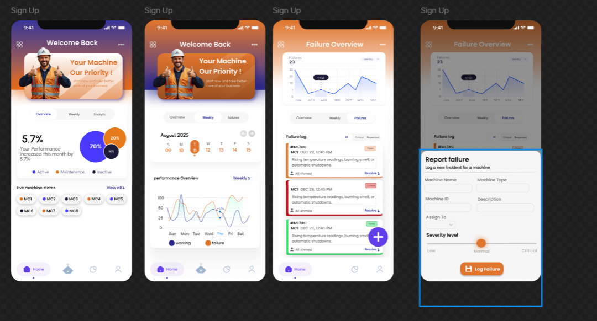
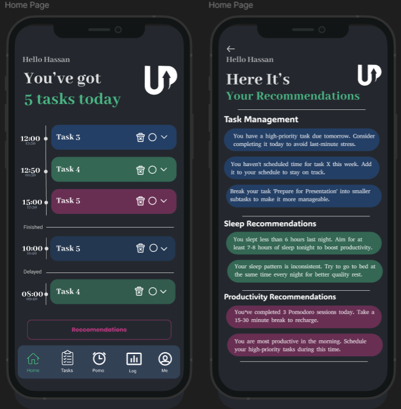

# Hassan Nasser | QA Portfolio

A testing-inspired portfolio presenting my software projects, QA experience, teaching, and community work. The design borrows the visual language of inspection tools and defect reports while keeping the work itself easy to explore.

**[View the portfolio](https://hassanelkashefportfolio.vercel.app)** · [LinkedIn](https://www.linkedin.com/in/hassan-elkashef-710582249/) · [Email](mailto:elkashefhassan1@gmail.com)


## Explore the portfolio

- **Project dossiers:** descriptions, technology stacks, interface previews, and image galleries.
- **Inspect mode:** optional annotations identifying sections and projects.
- **Sample defect report:** a labeled demonstration of observing an issue, documenting it, applying a fix, and verifying the corrected label.
- **Experience and community:** professional roles, education, teaching, and volunteering.
- **Dark/light themes:** saved locally between visits.
- **CV download and contact:** downloadable PDF, email links, and a configurable contact form.
- **Responsive interactions:** mobile navigation, keyboard-accessible dialogs, image zoom, scroll reveals, and reduced-motion support.

The sample issue is an interactive demonstration, not a real defect or an automated test execution. The Job Portal cover is illustrative; the other featured app visuals are interface screenshots.

### Featured application interfaces

<p align="center">
  
  
</p>

## Technology and architecture

| Layer | Implementation |
| --- | --- |
| Frontend | Angular 20, TypeScript, signals, and HttpClient |
| Styling | CSS themes, responsive layouts, transitions, and reduced-motion handling |
| Node hosting | Express 5 serves the API, images, CV, and compiled Angular application |
| Content | Editable JSON in `public/data/portfolio.json` |
| Contact email | Resend via Express or the Vercel function in `api/contact.js` |
| Deployment | Angular build with a Vercel configuration |

Angular requests `/api/portfolio` and can fall back to `/data/portfolio.json`. Portfolio browsing can run statically; contact-form delivery requires a configured server-side email endpoint.

## Run locally

Use Node.js 22.12+ from a compatible LTS release.

```bash
git clone https://github.com/hassannasserr/Hassan-Nasser-Mohamed-Portfolio.git
cd Hassan-Nasser-Mohamed-Portfolio
npm ci
npm run dev
```

Open **http://localhost:4200**. Angular proxies `/api` requests to the Express server on port 3000.

For the production build:

```bash
npm run build
npm start
```

Open **http://localhost:3000**. Windows users can also use `START-WINDOWS.bat`.

## Configure contact delivery

| Environment variable | Purpose |
| --- | --- |
| `RESEND_API_KEY` | Server-side email API credential |
| `RESEND_FROM_EMAIL` | Sender address authorized by your email provider |
| `PORT` | Optional Express listening port; defaults to `3000` |

Set these variables in the process or hosting environment. The code does not automatically load a `.env` file. Keep credentials out of frontend code and Git history.

For example, in PowerShell before `npm run dev`:

```powershell
$env:RESEND_API_KEY="YOUR_API_KEY"
$env:RESEND_FROM_EMAIL="Portfolio <contact@your-domain.com>"
```

The recipient comes from the `email` field in `public/data/portfolio.json`. Requests without an email-service credential receive a configuration error; provider delivery is not covered by the existing server test.

## Personalize the content

| File or folder | Change here |
| --- | --- |
| `public/data/portfolio.json` | Projects, experience, community entries, links, and recipient email |
| `public/images/` | Project screenshots and photographs |
| `public/Hassan_Nasser_CV.pdf` | Downloadable CV |
| `src/app/app.component.html` | Section content and markup |
| `src/app/app.component.ts` | Themes, filters, gallery, contact submission, and sample report state |
| `src/styles.css` | Colors, layout, motion, and responsive rules |

Rebuild before deployment after changing public content or assets.

## Checks

```bash
npm run check
npm run build
npm run test:server
```

The server test expects a completed build and checks portfolio data, API errors, compiled JavaScript delivery, image URLs, and byte-for-byte CV downloads. It does not exercise browser interactions or real email delivery.

## Deploy

### Vercel

Import this repository and use the included `vercel.json`:

| Setting | Value |
| --- | --- |
| Install command | `npm ci --include=dev` |
| Build command | `npm run build` |
| Output directory | `dist/portfolio/browser` |

Set email credentials in the deployment environment if the contact form is enabled. Verify that `/api/contact` reaches `api/contact.js` rather than the SPA fallback before relying on message delivery.

### Node host

Install dependencies, run `npm run build`, then start with `npm start`. Configure the environment variables on the host. The Express app serves both the frontend and its API.

## Project structure

```text
src/                  Angular application and styles
public/               Content, images, favicon, and CV
server/               Express application and route tests
api/contact.js        Vercel contact handler
angular.json          Angular build configuration
vercel.json           Deployment and rewrite configuration
```
